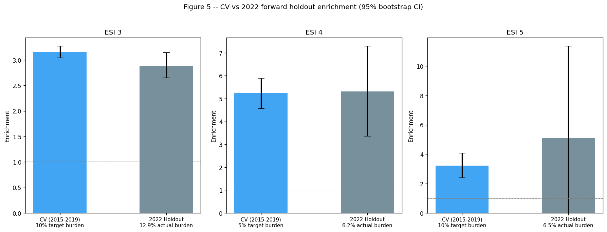
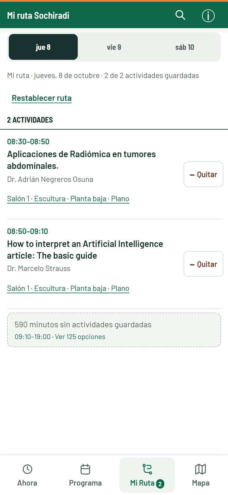

# Pablo Aguirre Araya

[Read in English](README.md) · **Español**

**Médico en Chile que desarrolla herramientas digitales para salud.**

Transformo necesidades de la práctica médica, la educación y el trabajo sanitario en prototipos funcionales. Combino contexto clínico, diseño de producto y desarrollo asistido por IA, y evalúo qué funciona y qué falta comprobar.

[Contacto](mailto:pablo.aguirre.araya@gmail.com) · [Investigación](https://github.com/pabloagar/triagegeist_competition) · [Demo educativa](https://paciente-cinco-demo.pablo-aguirre.chatgpt.site)

## Proyectos destacados

[IntraSight-ESI · investigación](https://github.com/pabloagar/triagegeist_competition) · [Paciente Cinco · educación](https://github.com/pabloagar/paciente-cinco) · [SOCHIRADI · congreso](https://github.com/pabloagar/mi-ruta-sochiradi) · [Biblioteca de Salud Ambiental](https://github.com/pabloagar/biblioteca-salud-ambiental-web)

### 1. IntraSight-ESI · Investigación retrospectiva

¿Tienen riesgos distintos los pacientes de un mismo estrato de triaje? Análisis público del NHAMCS con reserva temporal: **5,31× de enriquecimiento del desenlace** en el estrato principal. IMMEDR es una aproximación, no ESI confirmado; la validación clínica sigue pendiente.

*Figura original; las etiquetas ESI representan estratos IMMEDR del NHAMCS.*

[Investigación y metodología](https://github.com/pabloagar/triagegeist_competition) · [Notebook](https://www.kaggle.com/code/pabloaguirrearaya/intrasight-esi-v2)

### 2. Paciente Cinco · Beta educativa

Casos interactivos breves, decisiones y retroalimentación para practicar razonamiento clínico. **Beta jugable** con progreso local; contenido de demostración pendiente de revisión clínica y sin evaluación de resultados educativos.

[Proyecto](https://github.com/pabloagar/paciente-cinco) · [Probar la demo](https://paciente-cinco-demo.pablo-aguirre.chatgpt.site)

### 3. Mi ruta SOCHIRADI · Herramienta desplegada

Agenda móvil no oficial para elegir entre sesiones simultáneas de un congreso y conservar un itinerario personal. Analítica histórica: aproximadamente **140 visitas / 1.200 páginas vistas**, el 9–10 de octubre de 2026. Visitas no equivale a personas únicas; las páginas vistas incluyen navegación interna.

[Proyecto y límites de la medición](https://github.com/pabloagar/mi-ruta-sochiradi) · [Explorar la agenda](https://mi-ruta-sochiradi.pablo-aguirre-araya.workers.dev/)

### 4. Biblioteca de Salud Ambiental · MVP público

Encontrar recursos de salud ambiental por tema, formato y territorio chileno. **MVP público** con búsqueda, filtros y enlaces a fuentes originales; esta presentación se limita a la versión pública.

[Proyecto](https://github.com/pabloagar/biblioteca-salud-ambiental-web) · [Explorar la Biblioteca](https://biblioteca-salud-ambiental-chile-pablo.pablo-aguirre.chatgpt.site)

## Otras herramientas

**[Mapa cervical](https://github.com/pabloagar/mapa-cervical)** — anotaciones editables de un esquema cervical y salida A4. Prototipo de documentación funcional, sin diagnóstico automático. [Probar](https://mapa-cervical-salvador.pablo-aguirre.chatgpt.site).

## Cómo trabajo

Necesidad real → definición clínica y funcional → diseño → desarrollo asistido por IA → pruebas → evaluación.

Me interesa colaborar en salud, educación, diseño, investigación aplicada y hackatones. [Conversemos](mailto:pablo.aguirre.araya@gmail.com).
