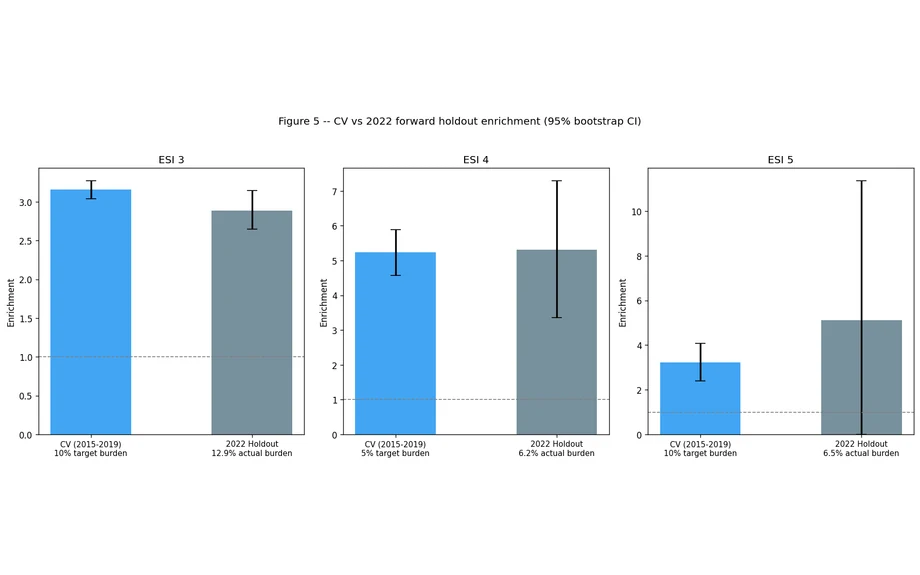
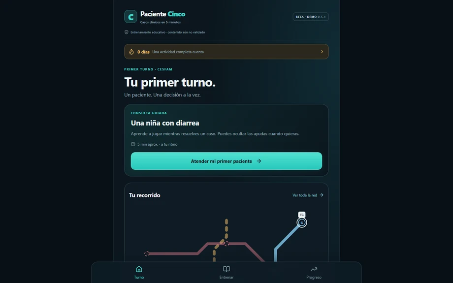
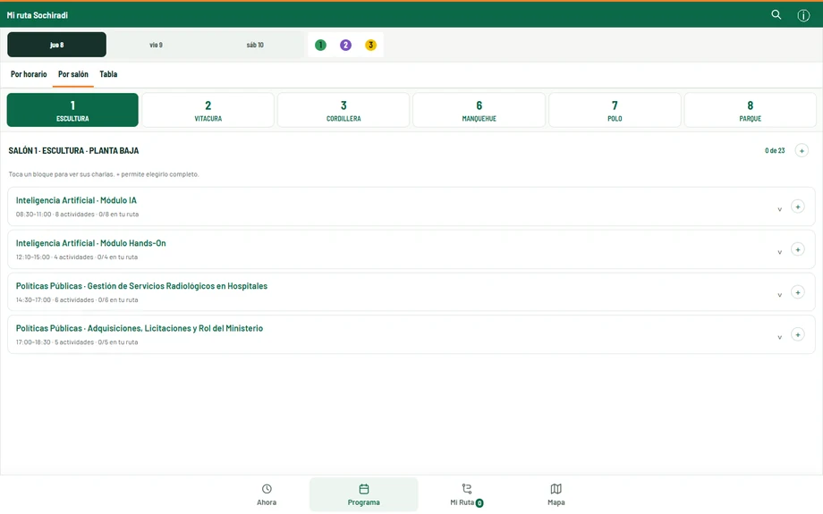
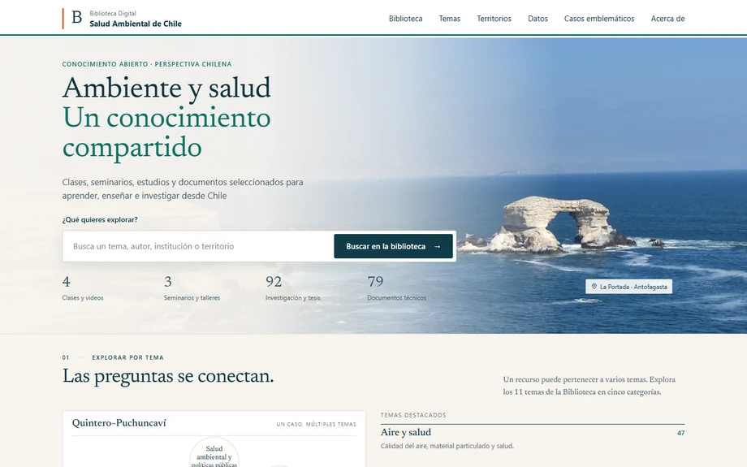

# Pablo Aguirre Araya

[English](README.md) · **Español**

**Médico y desarrollador · Arica, Chile**

Soy médico general de zona en Arica. Convierto necesidades de la práctica médica, la educación y la salud ambiental en herramientas que se puedan inspeccionar y probar.

Mi trabajo reúne la definición clínica del problema, el diseño de producto e interfaz y el desarrollo iterativo apoyado por IA. Documento qué funciona, qué evidencia lo respalda y qué falta evaluar.

[Contacto](mailto:pablo.aguirre.araya@gmail.com) · [Notebook de investigación](https://www.kaggle.com/code/pabloaguirrearaya/intrasight-esi-v2)

## Proyectos destacados

<table>
<tr>
<td width="50%" valign="top">
<h3><a href="https://github.com/pabloagar/triagegeist_competition/blob/main/README.es.md">IntraSight-ESI</a></h3>

Investigación retrospectiva con ML sobre riesgo dentro de un estrato de triaje. Notebook y resultados auditables.

<strong>Investigación · sin validación externa ni clínica. IMMEDR no es ESI confirmado.</strong>

<a href="https://www.kaggle.com/code/pabloaguirrearaya/intrasight-esi-v2">Notebook</a> · <a href="https://github.com/pabloagar/triagegeist_competition/blob/main/README.es.md">Proyecto y límites</a>

</td>
<td width="50%" valign="top">
<h3><a href="https://github.com/pabloagar/paciente-cinco/blob/main/README.es.md">Paciente Cinco</a></h3>

Casos clínicos breves, decisiones y retroalimentación para practicar razonamiento clínico.

<strong>Beta educativa jugable · revisión clínica del contenido pendiente.</strong>

<a href="https://paciente-cinco-demo.pablo-aguirre.chatgpt.site">Jugar demo</a> · <a href="https://github.com/pabloagar/paciente-cinco/blob/main/README.es.md">Proyecto y límites</a>

</td>
</tr>
<tr>
<td width="50%" valign="top">
<h3><a href="https://github.com/pabloagar/mi-ruta-sochiradi/blob/main/README.es.md">Mi ruta SOCHIRADI</a></h3>

Agenda no oficial del congreso con ruta personal, detección de solapamientos y mapa del recinto.

<strong>App publicada · congreso 2026 finalizado; visitas no equivalen a usuarios únicos.</strong>

<a href="https://mi-ruta-sochiradi.pablo-aguirre-araya.workers.dev/">Explorar app</a> · <a href="https://github.com/pabloagar/mi-ruta-sochiradi/blob/main/README.es.md">Proyecto y límites</a>

</td>
<td width="50%" valign="top">
<h3><a href="https://github.com/pabloagar/biblioteca-salud-ambiental-web">Biblioteca de Salud Ambiental</a></h3>

Recursos públicos de salud ambiental conectados por tema, territorio y fuente original.

<strong>MVP estático publicado · catálogo y fuentes originales disponibles.</strong>

<a href="https://pabloagar.github.io/biblioteca-salud-ambiental-web/">Abrir biblioteca</a> · <a href="https://github.com/pabloagar/biblioteca-salud-ambiental-web">Proyecto y límites</a>

</td>
</tr>
</table>

Capturas reales de las aplicaciones y una figura original de investigación. Las interfaces están en español. [Fuentes, fechas y vistas en tamaño completo](assets/projects/README.md).

## Investigación que puedes inspeccionar

IntraSight-ESI informa **5,31× de enriquecimiento del desenlace (intervalo bootstrap del 95 %: 3,36–7,30)** en la muestra reservada NHAMCS 2022, estrato IMMEDR 4, con un umbral congelado que señala el 6,2 % de los registros. Es un resultado retrospectivo y no ponderado dentro de ese conjunto de datos; no mide mejoras en desenlaces de pacientes, rendimiento en ESI confirmado ni rendimiento en Chile. [Métodos, resultados de desarrollo y límites](https://github.com/pabloagar/triagegeist_competition/blob/main/README.es.md#resultado-retrospectivo-principal).

## También exploro

[Mapa cervical](https://github.com/pabloagar/mapa-cervical/blob/main/README.es.md) — esquema anatómico editable para anotación manual y salida A4. Prototipo funcional; siguen pendientes la evaluación del flujo clínico y los permisos del material anatómico. [Abrir demo con estudio vacío](https://mapa-cervical-salvador.pablo-aguirre.chatgpt.site).

## Cómo trabajo

Parto de una necesidad concreta, construyo un prototipo utilizable y reviso su comportamiento y sus límites. Las comprobaciones de software, la validación clínica y los resultados educativos son evidencias diferentes.

Me interesa colaborar en herramientas de salud, educación médica, salud ambiental e investigación reproducible, incluidas su evaluación y las hackatones. [Conversemos](mailto:pablo.aguirre.araya@gmail.com).
